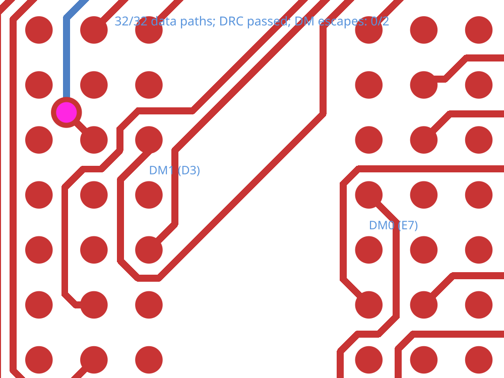

# A13 data routing blocks the pending RAM mask pads

The native OLIMEX A13 board completes all 32 data paths, with unchanged supplied copper and passing DRC, but the bus solver's escape search can no longer find an escape for RAM DM0 (E7) or DM1 (D3). Both pads have escapes before the RAM bytes are routed. The remaining 64 connections have not been routed in this reproduction.



The TSX and native PCB source are copied unchanged from [core-ddr-benchmark at 24dc44c](https://github.com/ShiboSoftwareDev/core-ddr-benchmark/tree/24dc44c166d4258c3538f8b1f66953f1b6f58690/circuits). The test freshly routes both RAM bytes after the 16 supplied CPU-side data paths. It checks all 32 paths, DRC and supplied-copper preservation before generating the SVG. Mask access uses the bus solver's existing site and package-exit searches; an escape is necessary access, not proof that the whole pending net can be routed.

```sh
bun test tests/a13-pending-mask-access.test.ts --timeout 900000
bun repros/a13-pending-mask-access/capture.tsx /path/to/core
```

The fixture uses the published Core 0.0.2396 inputs from [the release comparison](https://github.com/tscircuit/core/actions/runs/43921005346), with bus solver 0.0.58. Geometry, clearances, layer restrictions and logical nets are unchanged. No pending-intent producer is required.

The committed fixture uses the previously verified CPU-byte output. The capture command freshly routes all four data phases and records their requests before starting the remaining signals. The snapshot contains only completed data copper; it does not present the pending mask connections as routed.
