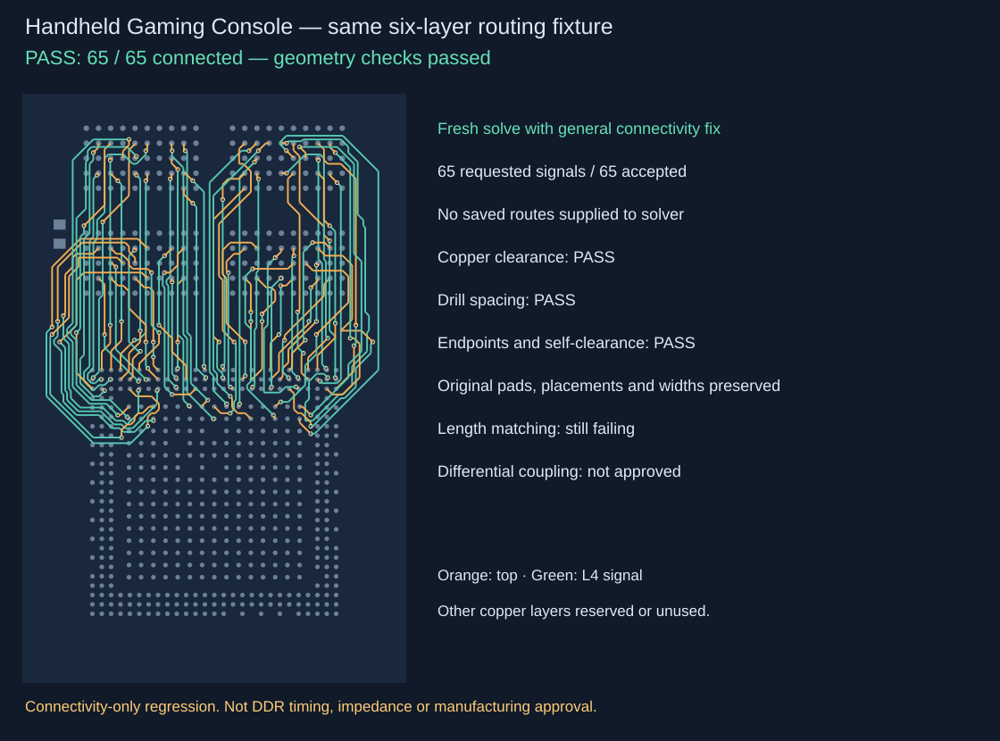

# Handheld Gaming Console connectivity regression

This fixture preserves native pad positions and all 65 requested signals. Its
fresh solve requires complete connectivity, endpoint continuity, copper
clearance, drill spacing and self-clearance before exporting a routed snapshot.
No saved routes seed the solve.

Run the regression from the repository root:

    bun test ./tests/handheld-routing-snapshot.test.ts

The test uses the repository-standard `toMatchSvgSnapshot(import.meta.path)`
matcher and compares against
`tests/__snapshots__/handheld-routing-snapshot.snap.svg`.

Regenerate the completed board image with:

    bun repros/handheld-gaming-console/routing-snapshot.ts

The runner has a 600-second cooperative budget. The active fixture uses six
physical layers. The original native board remains preserved for provenance.
The eight-layer SRJ is reconstructed from the active fixture and its recorded
source layer plan, then verified against the original byte hash. This avoids
a second copy of the pad geometry. Only completed, independently validated
routing can be exported.

The result establishes connectivity geometry. All six DDR bus groups still
fail length matching, and differential coupling remains unresolved. Completed
connectivity does not establish DDR timing or manufacturing readiness.

The solver uses one cell/stage search with three ordered escape policies: legal
terminal vias with drill-clear pruning, legal terminal vias with negotiated
drill spacing, then provisional terminal sites repaired before acceptance. All
policies share the outer step/time budget and the same final physical checks.
Refinement keeps the selected policy and supplied fixed copper immutable.
Repeated representations of one physical fixed via count as one hole. The
shared matched-routing heap is unchanged.

Run the drill-clearance regressions and seeded completion controls with:

    bun test tests/connectivity-review-regressions.test.ts tests/connectivity-completion-preservation.test.ts

Benchmark acceptance requires fresh paired solves of all eleven AM3352 cases
against the pinned main revision, including connectivity, DRC, total-copper bus
and pair skew, coupling and fixed-copper preservation. Current measurements and
revision IDs belong in the PR description and workflow artifacts.
