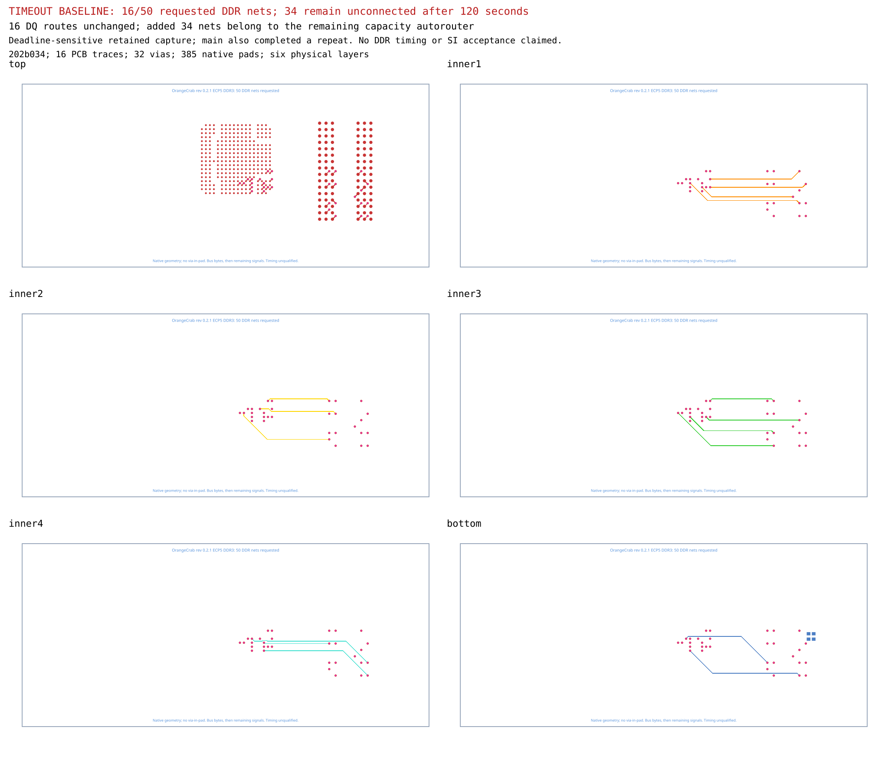

# OrangeCrab full DDR benchmark reproduction

This captures all **50 requested DDR signal nets** in core's OrangeCrab benchmark,
using the original placements of two BGA parts, two passive parts and 385 native
pads across six physical layers. Power, VREF, ZQ and unrelated circuitry are
outside the benchmark's scope. This is not a fully routed original OrangeCrab PCB
or an electrical DDR qualification.

The repro PR records pinned main's **120-second timeout: 16/50 nets**, consisting
only of its two completed eight-DQ byte phases. The remaining 34-net capacity
autorouter phase had not completed. The stacked solver PR replaces this same
SVG with a captured **50/50 completion**, 52 PCB traces and 109 vias, accepted by
core's native-pad geometry and physical routing checks.



**The 16 DQ routes are geometrically identical in both captures.** The additional
34 nets come from `AutoroutingPipelineSolver9_PreloadedTraceGraph`, not new
bus-lanes geometry. Main also completed OrangeCrab in an earlier repeat. This
before/after is a deadline-sensitive captured benchmark outcome, not a
deterministic OrangeCrab failure/fix or proof of a corridor-planning gain.

## Inspect or reproduce the snapshot

Install repository dependencies with `bun install`, then:

```sh
bun repros/orangecrab-full-board/snapshot.ts
```

The script reads the sealed retained capture and writes `board.snap.svg` and a
local `results/board.png` preview at one fixed viewport. All six physical copper
layers are shown. It verifies the captured circuit, assessment and progress
hashes; complete source byte-output hashes; unchanged 16-DQ route geometry; and
all 385 independently transformed native pad positions before rendering.
Successful export additionally requires 50/50 connected nets, all three phases
completed, zero physical findings and zero native geometry errors. The explicit
failed-baseline exception allows only the 16 previously accepted routes and
their 32 vias, with a visible timeout caption. It does not publish provisional
capacity-router copper.

This command revalidates and renders retained output. It performs **no fresh
routing** and establishes no fresh solve time. Capture provenance and acceptance
are in [capture/provenance.json](capture/provenance.json),
[capture/assessment.json.gz](capture/assessment.json.gz),
[capture/progress.json.gz](capture/progress.json.gz) and
[snapshot-report.json](snapshot-report.json).

## Fresh benchmark solve

Use core `1a16da2f74fc2c80712d52abb17254dd2a80e2c5` and fixture package
`24dc44c166d4258c3538f8b1f66953f1b6f58690`, with Bun 1.4.3 and the recorded
installed dependency versions. Resolve core's bus-lanes dependency to the
desired pinned solver build, preserving the other dependencies. From that core
checkout:

```sh
bun run benchmark:ddr --circuit orangecrab --timeout 120 --out /tmp/orangecrab-fresh
```

Read `results.json` for the actual outcome; solver failures and timeouts are
measured outcomes, not necessarily nonzero command exits. A fresh run may finish
on either revision. The original complete benchmark comparison and dependency
inventory are linked from [PR #218](https://github.com/tscircuit/bus-lanes-solver/pull/218).

To export another compatible benchmark capture, retain its root `provenance.json`
with source/build pins as in the original comparison, then:

```sh
bun repros/orangecrab-full-board/snapshot.ts \
  --capture /tmp/orangecrab-fresh --state completed
```

The default export destination is this repro. `--output /tmp/orangecrab-preview`
keeps a proposed capture separate. A completed export refuses any incomplete or
invalid result. This is a routing-only benchmark: no length/skew, differential
coupling, impedance or timing constraint is invented.

## Source and license

The native source is [OrangeCrab r0.2.1 at commit c511d569](https://github.com/orangecrab-fpga/orangecrab-hardware/blob/c511d569fe2af39467041f888bc231020f40c6ac/hardware/orangecrab_r0.2.1/OrangeCrab.kicad_pcb),
SHA-256 `4597f3ac08e21c09253b27ca1b9e26aaf3c3d3e2147b6c0d79c0dc6aa555e201`.
The modified extraction is included in `source/orangecrab.json.gz`; its metadata
records the original source, selected nets, native layers and conversion scope.
The original hardware is under [CERN OHL v1.2](source/LICENSE.hardware.txt).

Benchmark effect: this reproduction adds retained evidence and a snapshot
export command. It changes no solver code, benchmark input, routing budget or
acceptance rule. The solver PR's fresh core and eleven-sample AM3352 comparisons
remain separate from retained-image revalidation.
